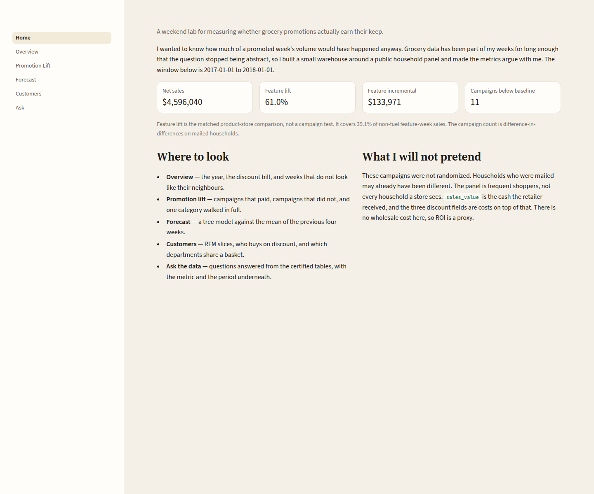
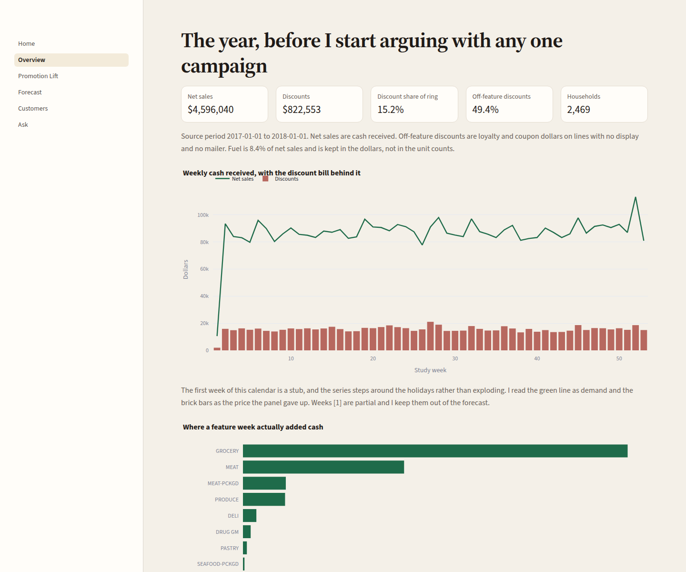
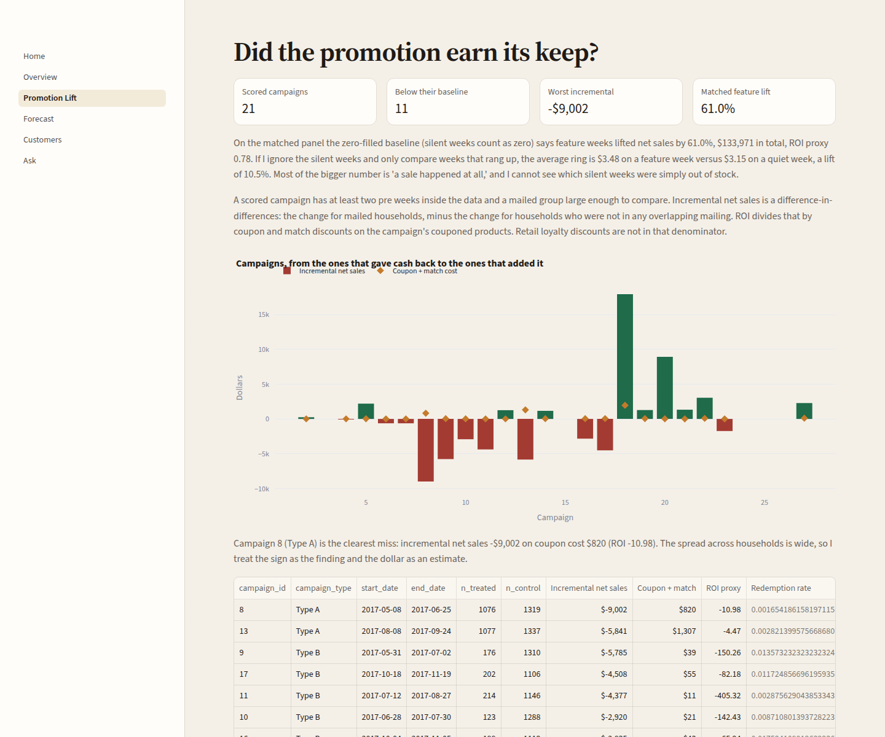
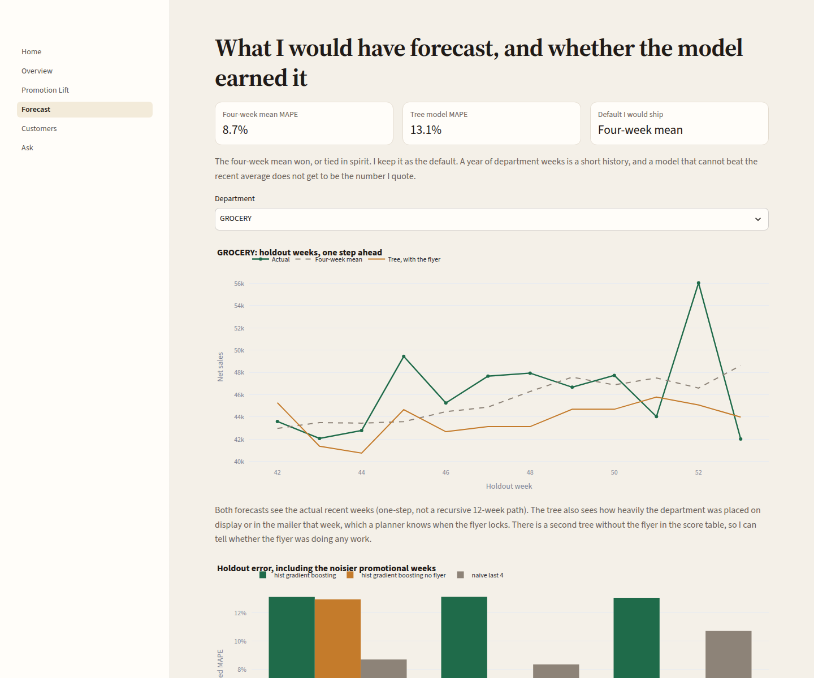
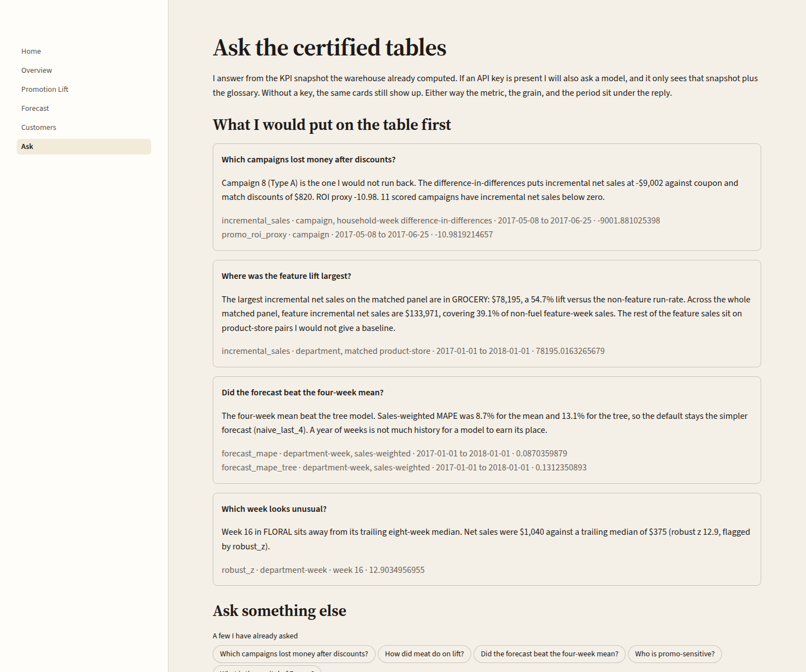
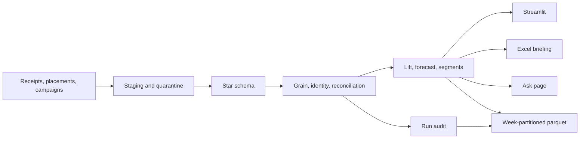

# promo-lift lab

A weekend lab for measuring whether grocery promotions actually earn their keep.

## Why I built this

I wanted to know how much of a promoted week's volume would have happened anyway. A yellow tag moves units. It also moves the weeks I would have sold those units in. Without a baseline, every spike looks like a win.

Planning weekly orders and sales planners on the grocery floor at Loblaws is what made the question stop being abstract. I built this on the public Complete Journey household panel, not on store data from work, so I could argue with the numbers on my own time: cash received, discount cost, a baseline, and the campaigns that do not pay.

## What you can explore

The app reads certified marts. Nothing on a page is computed in the button that draws it.











The written pass is [`docs/executive-brief.md`](docs/executive-brief.md). The formulas are in [`docs/metrics-glossary.md`](docs/metrics-glossary.md).

## What the year actually did

Study window 1 January 2017 to 1 January 2018, the calendar the Complete Journey mirror uses. 2,469 households, 1,469,307 receipt lines, 155,848 baskets.

- **Net sales were $4,596,039.58.** Recorded discounts were $822,553.19, which is 15.18% of the pre-discount ring ($5,418,592.77). **49.43% of the discount dollars sat on lines with no display and no mailer.** A feature is not where most of the discount bill lives.
- **On 27,555 product-store pairs with a baseline** (39.10% of non-fuel feature-week sales), counting silent weeks as zero, feature weeks added **$133,971.26** of net sales. That is a **60.97%** lift. The ROI proxy, that increment divided by the discounts on those feature weeks ($172,181.45), is **0.78**. The extra cash did not cover the discount bill.
- **Most of that 60.97% is "a sale happened."** On weeks that actually rang up, the average ring was **$3.48** on a feature week against **$3.15** on a quiet week, a lift of **10.50%** (107,083 feature weeks, 303,347 quiet weeks). I cannot see which silent weeks were out of stock, so I quote both.
- **11 of 21 scored campaigns** have incremental net sales below zero. Campaign 8 (Type A, 8 May 2017 to 25 June 2017, 1,076 mailed households) is the clearest miss: **−$9,001.88** incremental net sales against **$819.70** of coupon and match discounts, ROI proxy **−10.98**. Campaign 18 (Type A) is the largest positive gap: **$17,943.99** on a coupon bill of **$1,964.72**, ROI proxy **9.13**. Some other ROI figures are nonsense because the coupon bill is a few dollars. I rank on the incremental dollars.
- **The four-week mean beat the tree.** Sales-weighted MAPE on the last 12 weeks was **8.70%** for the mean of the previous four weeks and **13.12%** for the gradient-boosted model (12.96% without the flyer). Grocery alone was 6.31% versus 7.36%. The default forecast is the four-week mean.
- **653 households (26.45%)** put at least 18% of their pre-discount ring on a recorded discount, with at least 8 baskets. Champions are 496 households (20.09%) and **$2,059,155.24** of net sales (44.80%). Meat and packaged meat share a basket at a lift of **2.08**.

Deli meats is the category I would walk through: 470 pairs, feature-week sales $6,926.22, quiet-week run-rate $4,601.67, gap $2,324.55 (50.52%), discounts $1,107.22, ROI proxy 2.10. It is one of the few places the extra cash covered the discount. The campaign test is stricter than that, and it is the one I would defend.

Fact sales reconciled to staging with a drift of about a hundred-millionth of a dollar. The build fails if that drift exceeds $1 or 0.01%.

## How the lab is put together



`make pipeline` is the path I actually want: land the files, rebuild the warehouse, fail the run if a total drifts, and publish the marts into week folders. One `run_id` ties the steps, the quality results, and the lineage together. I added that because a Monday planner is dated and checked; a rebuild should be too.

## Data

Credit to 84.51° and the Complete Journey study, via the public files shipped with Bradley Boehmke and Steven Mortimer's [`completejourney`](https://github.com/bradleyboehmke/completejourney) package. I download those mirrors. Raw files are not in git.

If the mirrors are missing, ingest falls back to the [UCI Online Retail II](https://archive.ics.uci.edu/dataset/502/online+retail+ii) extract and says so. That file has no campaigns, so feature flags become "price at least 15% under the product's own median." If you already have the Kaggle CSVs (`frtgnn/dunnhumby-the-complete-journey`), `python scripts/ingest.py --source kaggle-csv --dir data/raw/kaggle` maps them onto the same staging tables. I do not download Kaggle from here.

`FULL_BUILD=1` is the default and loads every placement. `FULL_BUILD=0` keeps promotions only for products that actually sold. The promotions file is about 21 million rows before I collapse a few thousand duplicate product-store-weeks. Joining those duplicates onto receipts would double-count the lines.

Gasoline quantity in this extract is on a different scale (about a thousand units per gallon). Unit totals exclude fuel. Fuel is 8.36% of net sales and stays in the dollars.

More on grains, the discount sign, and what this cannot support: [`docs/data-notes.md`](docs/data-notes.md).

## Quick start

```bash
cp .env.example .env
docker compose up -d
python -m venv .venv && source .venv/bin/activate
pip install -r requirements.txt
make pipeline && make app
```

`make pipeline` runs ingest, build, tests, and export under one run id. `make ingest` still downloads the mirrors into `data/raw` (not committed) and loads staging if you want the steps one at a time. `make build` rebuilds the star schema, refuses to continue if the totals drift, and writes the marts. `make test` runs the unit tests and, when Postgres is up, the SQL assertions. After a successful pipeline run, the marts also land in `exports/curated/` as parquet, with one folder per study week where the grain is weekly.

The ask page works with no API key. It answers from the certified snapshot and prints the metric, the grain, and the period. If you set `OPENAI_API_KEY` (and `pip install openai`), the same page will also ask a model. The model only receives the aggregate snapshot and the glossary, not household rows. `LLM_MODEL` defaults to `gpt-4o-mini`.

A question from the shell:

```bash
python -m insights.answer "Which campaigns lost money after discounts?"
```

CI uses the committed slice in `data/fixtures` and does not download anything. That slice is real rows. It is not big enough to re-estimate the findings above. CI runs `python scripts/run_pipeline.py --source fixtures`.

## What's in each folder

- `warehouse/` — staging, the star schema, the views I will quote, and the `ops` run audit.
- `quality/` — the contracts and the assertions that fail the build.
- `analysis/` — lift, the forecast horse-race, segments, baskets, anomalies.
- `app/` — the five pages.
- `insights/` — the question layer, templated unless a key is set.
- `exports/` — the Excel briefing, the CSV extracts, and week-partitioned parquet under `exports/curated/`.
- `docs/` — the question, the formulas, the process, and the brief.
- `scripts/` — ingest, build, export, and `run_pipeline.py` for a single run id.
- `data/fixtures/` — the small slice CI runs on.

## How I define the numbers

[`docs/metrics-glossary.md`](docs/metrics-glossary.md). The short version: net sales are cash the retailer received. Gross adds the three discount fields back. Baseline is the product-store's own non-feature weeks, silent weeks included as zero, and I also publish the conditional ring so the 61% is not doing quiet work. Incremental sales are never quoted without that method. Campaign ROI is incremental net sales divided by coupon and match discounts. Forecast MAPE is sales-weighted, on the last 12 weeks, one step ahead. A household is promo-sensitive at an 18% discount share of the pre-discount ring and at least 8 baskets.

## Limits

These campaigns were not randomized. Someone chose the mailed households. The panel is frequent shoppers, not every household a store sees. There is no cost of goods, so ROI is not a margin. The promotions file is large, and the matched baseline covers 39% of non-fuel feature sales, not all of them. The optional model can phrase a true number badly. The sources under the answer are the check. This mirror has no negative quantities, so I do not report a return rate.

## License and thanks

MIT, see [LICENSE](LICENSE).

Thanks to 84.51° for the study, and to the `completejourney` maintainers for the mirrors that made a no-login rebuild possible.
