# What I used to do, and what I do in this lab

The "current" picture is the way I first poked at this question: open the receipts, group a week, stare at a spike, and call it a lift. The "intended" picture is the path I actually wanted, where a number survives a check before I repeat it.

```mermaid
flowchart TB
  subgraph current [How the question usually dies]
    a[Download a file] --> b[Pivot a week in a notebook]
    b --> c[See a spike during a campaign]
    c --> d[Call the spike incremental]
    d --> e[Forget the definition a week later]
  end
  subgraph intended [How I wanted it to work]
    f[Land the files in staging] --> g[Quarantine rows I will not defend]
    g --> h[Build a star schema with the grains written down]
    h --> i[Fail the build if totals drift]
    i --> j[Estimate a baseline and a comparison group]
    j --> k[Write the result to a named mart]
    k --> l[Read it in the app, the briefing, or a question]
    l --> m[Keep the formula next to the figure]
  end
```

The gap that matters is between "a spike" and "a spike minus a baseline, with the method named." Everything else in the repo is there to make that gap expensive to skip.
