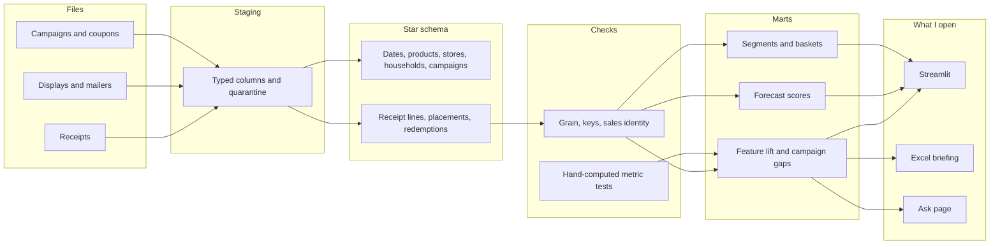

# From a pile of files to a number I would defend

The rule in the middle is the one I care about. Nothing on the right is allowed to recompute a metric that the checks have not already seen. The app reads views. The ask page reads the snapshot those views were written to.
